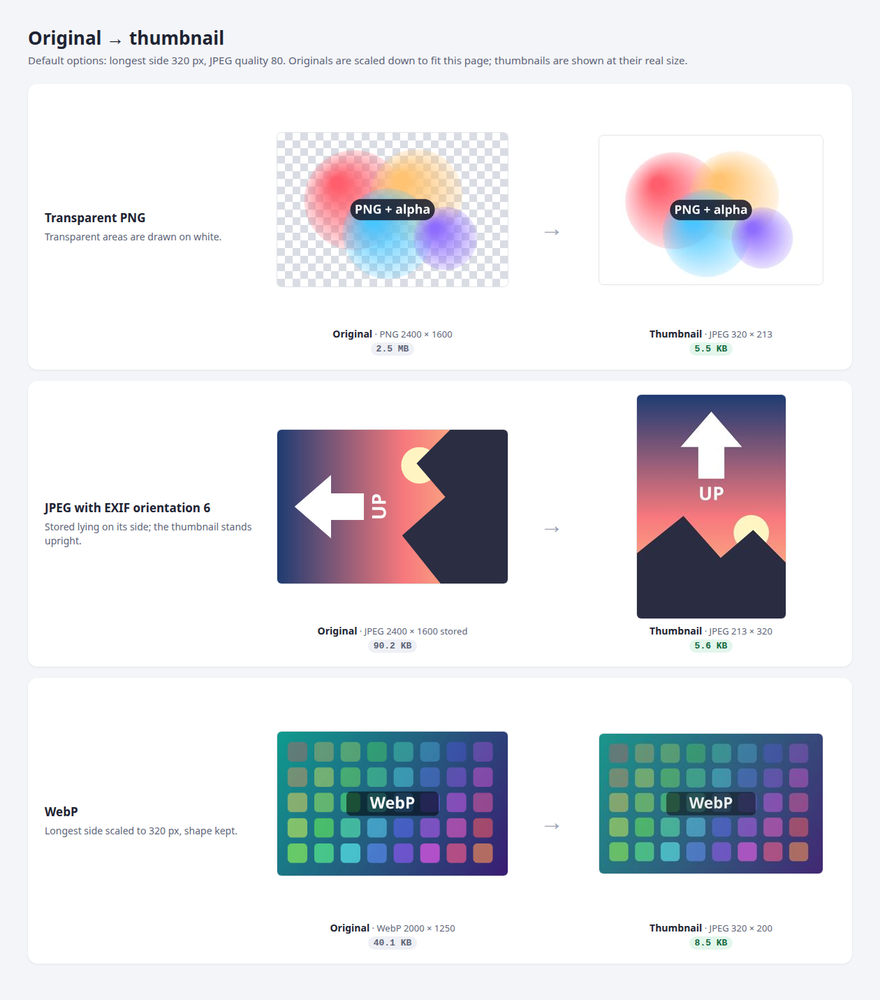
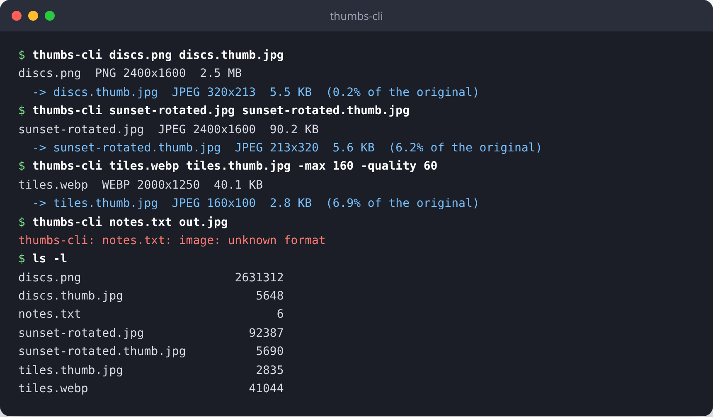

# thumbs

[](https://pkg.go.dev/github.com/ez-technologies/thumbs)
[](LICENSE)

Small, dependable JPEG thumbnails in Go. Hand `thumbs` a JPEG, PNG or WebP image and get back a JPEG no larger than
320 pixels on its longest side, standing the right way up, with transparent areas on white. One function call, no
cgo, no external tools.

```go
thumb, err := thumbs.Make(file) // []byte, a JPEG
```



## What it does

- **Reads JPEG, PNG and WebP.** Decoding uses the standard library and `golang.org/x/image/webp`; the result is
  always a JPEG.
- **Turns photos upright.** A JPEG's EXIF orientation (all eight values, including the mirrored ones) is applied
  before scaling, so a picture a phone saved on its side comes out standing up.
- **Draws transparency on white.** Transparent and semi-transparent areas of a PNG or WebP are blended onto a white
  background, since JPEG has no alpha channel.
- **Scales by the longest side.** The longest side becomes at most `MaxSide` pixels (320 by default) and the other
  side keeps the proportion. Scaling uses the Catmull-Rom filter. An image that is already small enough is never
  enlarged, only re-encoded.
- **Lets you choose the quality.** JPEG quality 1 to 100, 80 by default.

## Install

```sh
go get github.com/ez-technologies/thumbs
```

Requires Go 1.26 or later.

## Quick start

```go
package main

import (
	"log"
	"os"

	"github.com/ez-technologies/thumbs"
)

func main() {
	f, err := os.Open("photo.jpg")
	if err != nil {
		log.Fatal(err)
	}
	defer f.Close()

	thumb, err := thumbs.Make(f) // 320 px longest side, JPEG quality 80
	if err != nil {
		log.Fatal(err) // not a JPEG, PNG or WebP image, or a read error
	}
	if err := os.WriteFile("photo"+thumbs.Suffix, thumb, 0o644); err != nil {
		log.Fatal(err)
	}
}
```

## Screenshots

**Before and after** (top of this page). Three synthetic sample images run through `thumbs.Make` with the default
options. Originals are scaled down to fit; thumbnails are shown at their real size.

- *Transparent PNG*, 2400 × 1600, 2.5 MB: shown on a checkerboard so the transparency is visible. The thumbnail,
  320 × 213 and 5.5 KB, has the transparent areas drawn on white.
- *JPEG with EXIF orientation 6*, stored 2400 × 1600 lying on its side: the thumbnail is 213 × 320 and upright.
- *WebP*, 2000 × 1250: the thumbnail is 320 × 200 with the same proportions.

**The example command line tool** ([`examples/thumbs-cli`](examples/thumbs-cli)) on the same images, including
a custom size and quality and a file that is not an image:



## How to

### Make a thumbnail with the defaults

```go
thumb, err := thumbs.Make(r) // r is any io.Reader: a file, an HTTP body, a bytes.Reader
```

### Choose the size and quality

```go
thumb, err := thumbs.MakeWith(r, thumbs.Options{MaxSide: 200, Quality: 85})
```

A zero field means its default, so `thumbs.Options{MaxSide: 640}` keeps quality 80.

### Store the thumbnail next to the original

`thumbs.Suffix` is `".thumb.jpg"`, a convention for keeping the pair together: `photo.png` and `photo.png.thumb.jpg`,
or `uploads/42` and `uploads/42.thumb.jpg` in object storage. Whoever reads the original can find its thumbnail
without a lookup table.

```go
if err := os.WriteFile(key, original, 0o644); err != nil {
	return err
}
return os.WriteFile(key+thumbs.Suffix, thumb, 0o644)
```

### Use it in an HTTP upload handler

Read the upload once, make the thumbnail (which also checks that the upload really is a picture), then store both.
The complete server, with tests, is in [`examples/upload`](examples/upload).

```go
func upload(w http.ResponseWriter, r *http.Request) {
	r.Body = http.MaxBytesReader(w, r.Body, 20<<20)
	file, header, err := r.FormFile("file")
	if err != nil {
		http.Error(w, "expected a multipart field named file", http.StatusBadRequest)
		return
	}
	defer file.Close()
	data, err := io.ReadAll(file)
	if err != nil {
		http.Error(w, "upload too large or cut short", http.StatusRequestEntityTooLarge)
		return
	}

	thumb, err := thumbs.Make(bytes.NewReader(data))
	if err != nil {
		http.Error(w, "not a JPEG, PNG or WebP image", http.StatusUnsupportedMediaType)
		return
	}

	name := filepath.Join(dir, filepath.Base(header.Filename)) // never trust a path from the client
	if err := os.WriteFile(name, data, 0o644); err != nil {
		http.Error(w, "could not store the original", http.StatusInternalServerError)
		return
	}
	if err := os.WriteFile(name+thumbs.Suffix, thumb, 0o644); err != nil {
		http.Error(w, "could not store the thumbnail", http.StatusInternalServerError)
		return
	}
	w.WriteHeader(http.StatusCreated)
}
```

Try it:

```sh
go run ./examples/upload -dir ./uploads -addr :8080
curl -F file=@photo.jpg http://localhost:8080/upload
# {"original":"photo.jpg","original_bytes":92387,"thumbnail":"photo.jpg.thumb.jpg","thumbnail_bytes":5690}
```

### Use the command line tool

```sh
go install github.com/ez-technologies/thumbs/examples/thumbs-cli@latest
thumbs-cli in.jpg out.jpg -max 320 -quality 80
```

Flags may come before or after the file names.

## API

| Name | What it is |
| --- | --- |
| `Make(r io.Reader) ([]byte, error)` | Thumbnail with the default options. |
| `MakeWith(r io.Reader, opts Options) ([]byte, error)` | Thumbnail with your options. |
| `DefaultMaxSide` | `320` |
| `DefaultQuality` | `80` |
| `Suffix` | `".thumb.jpg"` |

### Options

| Field | Type | Default (zero value) | Meaning |
| --- | --- | --- | --- |
| `MaxSide` | `int` | `320` | Longest side of the thumbnail in pixels. Smaller images are not enlarged. |
| `Quality` | `int` | `80` | JPEG quality, 1 (smallest) to 100 (best). |

Both functions return an error when the input cannot be read or is not a JPEG, PNG or WebP image. The whole input is
read into memory and decoded at full size before scaling, so limit upload sizes accordingly (as the handler above
does with `http.MaxBytesReader`).

## Tests

```sh
go test ./...
```

The tests cover scaling by the longest side (wide and tall), not enlarging small images, the options, refusing input
that is not an image, and EXIF orientation. The examples have their own tests: the command line tool's flags and
output, and the upload handler storing an original with its thumbnail and refusing a non-image.

## Licence

MIT, see [LICENSE](LICENSE).
